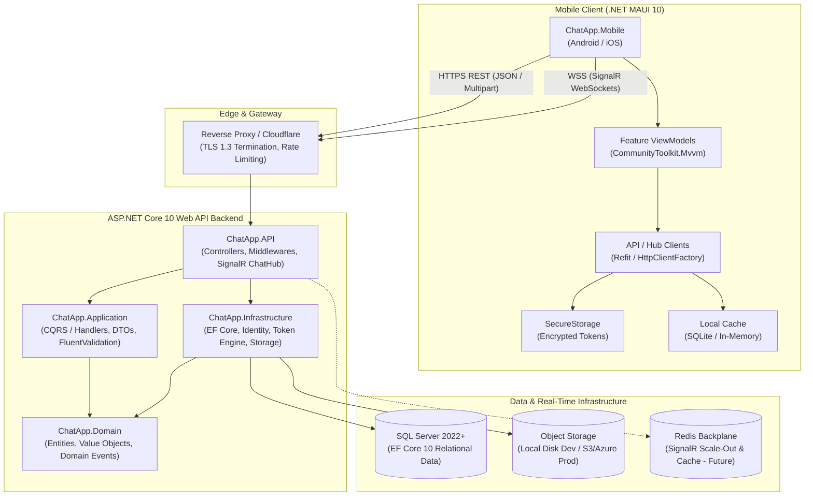
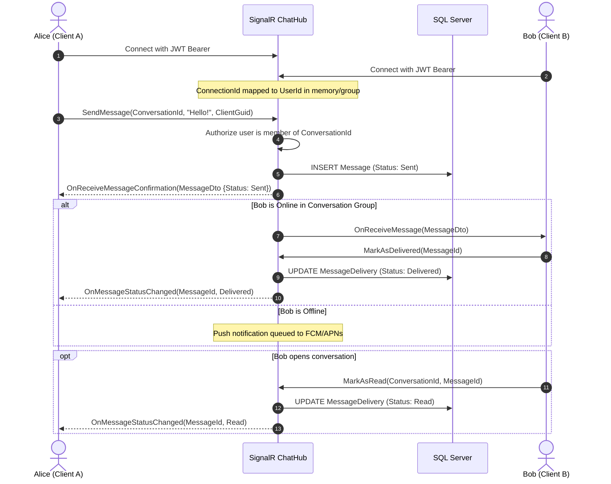
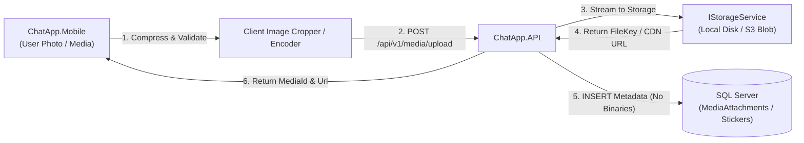

# ChatApp — System & Application Architecture Document

**Document Version:** 1.0.0  
**Phase:** 1 — Product Discovery & Architecture  
**Architect:** Senior Software Architect & Technical Lead  
**Target Platform:** .NET 10 (ASP.NET Core Web API + .NET MAUI Mobile App)  

---

## 1. High-Level System Architecture

ChatApp employs a **Decoupled Clean Architecture** with a high-performance **Modular Monolith** backend and a **Feature-Driven MVVM** client on .NET MAUI.

### 1.1 Architectural Topology Diagram



---

## 2. Backend Architecture: Clean & Modular Monolith

### 2.1 Architectural Decision: Modular Monolith vs. Microservices
- **Decision:** Build as a unified, well-structured **Modular Monolith** organized by clean architecture layers, not microservices.
- **Justification:** At this stage, microservices would introduce excessive operational overhead (distributed transactions, service discovery, network latency, multiple deployment pipelines, serialization overhead). A clean modular monolith enforces strict boundaries within a single deployable unit while keeping the migration path to microservices friction-free if scale demands it in the future.

### 2.2 Solution & Project Structure

```
ChatApp/
├── ChatApp.Backend/
│   ├── ChatApp.Backend.sln
│   ├── src/
│   │   ├── ChatApp.Domain/              # Zero external dependencies
│   │   │   ├── Common/                  # BaseEntity, AuditableEntity, ValueObjects
│   │   │   ├── Entities/                # User, Conversation, Message, StickerPack, etc.
│   │   │   ├── Enums/                   # MessageType, DeliveryStatus, ParticipantRole
│   │   │   └── Exceptions/              # DomainException, NotFoundException
│   │   │
│   │   ├── ChatApp.Application/         # Pure application business logic
│   │   │   ├── Common/                  # Interfaces (ICurrentUser, IDateTime, IStorageService)
│   │   │   ├── Features/                # Feature-sliced logic
│   │   │   │   ├── Auth/                # Commands, Queries, DTOs, Validators
│   │   │   │   ├── Users/
│   │   │   │   ├── Conversations/
│   │   │   │   ├── Messages/
│   │   │   │   └── Stickers/
│   │   │   └── Behaviors/               # ValidationPipeline, PerformanceLogging
│   │   │
│   │   ├── ChatApp.Infrastructure/      # External tech implementations
│   │   │   ├── Persistence/             # AppDbContext, EntityConfigurations, Migrations
│   │   │   ├── Identity/                # IdentityService, JwtTokenGenerator, TokenHasher
│   │   │   ├── Storage/                 # LocalFileStorageService, S3StorageService
│   │   │   └── Services/                # DateTimeService, MediaCompressorService
│   │   │
│   │   └── ChatApp.API/                 # Presentation & Entry Point
│   │       ├── Controllers/             # REST Endpoints (v1)
│   │       ├── Hubs/                    # SignalR ChatHub
│   │       ├── Middlewares/             # CentralizedExceptionMiddleware, RateLimiting
│   │       ├── Filters/                 # ApiExceptionFilter, ValidationFilter
│   │       ├── Extensions/              # ServiceCollectionExtensions
│   │       ├── Program.cs               # Minimal hosting & pipeline configuration
│   │       └── appsettings.json
│   │
│   └── tests/
│       ├── ChatApp.UnitTests/           # Unit tests for Domain and Application handlers
│       └── ChatApp.IntegrationTests/    # WebApplicationFactory + TestContainers / LocalDB
```

### 2.3 Layer Principles & Dependency Inversion
1. **Domain:** Enterprise business models, domain events, business invariants. Does not reference any other layer or external package (not even EF Core).
2. **Application:** Orchestrates use cases. Defines interfaces for repositories, services, and storage. Uses FluentValidation for request validation. References only `Domain`.
3. **Infrastructure:** Implements interfaces defined in `Application`. Houses EF Core `DbContext`, ASP.NET Core Identity integration, disk/cloud storage services, and JWT crypto.
4. **API:** Exposes HTTP endpoints and SignalR hubs. Translates HTTP requests and WebSocket packets into Application use-cases. Houses middleware, Swagger, CORS, and health checks.

### 2.4 Data Access Strategy: EF Core without Unnecessary Repositories
- **Decision:** Do not create generic `IRepository<T>` wrappers over EF Core `DbSet<T>`.
- **Justification:** EF Core `DbContext` is already a battle-tested Unit of Work, and `DbSet<T>` is a Repository. Generic wrappers obscure EF Core's powerful querying capabilities (projection via `.Select()`, explicit navigation loading, split queries, and change tracking controls like `.AsNoTracking()`). For complex domain queries, specialized query extensions or scoped domain services are used.

---

## 3. Mobile Application Architecture (.NET MAUI)

### 3.1 Architectural Principles
- **Pattern:** Model-View-ViewModel (MVVM) powered by `CommunityToolkit.Mvvm`.
- **Compiled Bindings:** Mandatory `x:DataType` on all XAML views and data templates to ensure compile-time type verification, zero reflection overhead, and 60 FPS rendering.
- **Separation of Concerns:** Zero business or data logic inside code-behind (`.xaml.cs`). Code-behind is reserved exclusively for platform-specific animations and direct UI manipulations.
- **Dependency Injection:** Native MAUI `IServiceCollection` configured inside `MauiProgram.cs` registering Pages, ViewModels, and Services with explicit lifetimes (ViewModels and Pages as `Transient`, single-instance State and API services as `Singleton`).

### 3.2 Feature-Based Folder Structure

```
ChatApp.Mobile/
├── App.xaml / App.xaml.cs
├── AppShell.xaml / AppShell.xaml.cs
├── MauiProgram.cs
├── Features/
│   ├── Authentication/
│   │   ├── Models/
│   │   ├── Services/           # IAuthApiService
│   │   ├── ViewModels/         # LoginViewModel, RegisterViewModel
│   │   └── Views/              # LoginPage.xaml, RegisterPage.xaml
│   ├── Conversations/
│   │   ├── Models/
│   │   ├── ViewModels/         # ConversationsViewModel, SearchUsersViewModel
│   │   └── Views/              # ConversationsPage.xaml, UserSearchPage.xaml
│   ├── Chat/
│   │   ├── Models/             # MessageBubbleItem
│   │   ├── Services/           # IChatHubClientService
│   │   ├── ViewModels/         # ChatViewModel
│   │   └── Views/              # ChatPage.xaml
│   ├── Stickers/
│   │   ├── Services/           # IStickerMakerService
│   │   ├── ViewModels/         # StickerStudioViewModel, StickerPacksViewModel
│   │   └── Views/              # StickerStudioPage.xaml, StickerPickerView.xaml
│   └── Profile/
│       ├── ViewModels/         # ProfileViewModel
│       └── Views/              # ProfilePage.xaml
├── Controls/                   # Reusable cross-feature controls
│   ├── MessageBubble.xaml
│   ├── MessageInputBar.xaml
│   ├── AvatarView.xaml
│   ├── StateContainer.xaml     # Loading / Error / Empty state switcher
│   └── BadgeIndicator.xaml
├── Converters/                 # Value converters (DateToReadableTime, BoolToVisibility)
├── Behaviors/                  # EventToCommandBehavior, SafeKeyboardScrollBehavior
├── Navigation/                 # INavigationService, AppRoutes
├── Resources/
│   ├── Fonts/                  # Cairo-Regular.ttf, Cairo-Bold.ttf, Inter-Regular.ttf
│   ├── Images/
│   ├── Styles/                 # Colors.xaml, Typography.xaml, ButtonStyles.xaml
│   └── Themes/                 # LightTheme.xaml, DarkTheme.xaml
```

### 3.3 Navigation Architecture
- **Centralized Navigation Service:** An abstraction (`INavigationService`) wrapping `Shell.Current.GoToAsync` to prevent ViewModels from holding tight dependencies on UI Shell references.
- **Route Registration:** Explicit route declarations in `AppShell.xaml.cs`:
  - `//login` -> `LoginPage`
  - `//register` -> `RegisterPage`
  - `//main/conversations` -> `ConversationsPage`
  - `//main/chat` -> `ChatPage` (parameters: `conversationId`, `recipientId`)
  - `//main/sticker-studio` -> `StickerStudioPage`

### 3.4 Design System & Styling Tokens
- **Centralized Tokens:** Defined in `Resources/Styles/Colors.xaml` and `Typography.xaml`.
- **Dynamic Theming:** DynamicResource references enabling seamless on-the-fly toggling between Light and Dark modes.
- **RTL & LTR Support:** Global directionality detection with Cairo font applied for Arabic text, ensuring mirrored horizontal alignments for message bubbles and icons.

---

## 4. Real-Time Communication Architecture (SignalR)

### 4.1 Topology & Protocols
- **Transport:** WebSocket primary transport with fallback to Server-Sent Events / Long Polling.
- **Endpoint:** `/hubs/chat`
- **Handshake Authentication:** JWT passed in query string `access_token` during WebSocket upgrade, captured by ASP.NET Core `JwtBearerOptions.Events.OnMessageReceived`.

### 4.2 SignalR Communication Flow Diagram



### 4.3 Connection Lifecycle & Offline Reconnection
1. **Heartbeat & Keep-Alive:** Default 15-second client keep-alive interval.
2. **Exponential Backoff:** If disconnection occurs, client initiates retry at 0s, 2s, 5s, 10s, up to 30s max.
3. **Synchronization on Reconnect:** Upon re-establishing connection, client sends `SyncMessages(lastKnownMessageId)` to retrieve any messages or status updates missed during offline downtime.

---

## 5. Security & Privacy Architecture

### 5.1 Authentication & Token Lifecycle
- **Access Tokens:** Signed with HMAC-SHA256 (or RSA-256 for external verification), containing `sub` (UserId), `email`, `jti`, and `exp`. Short expiry of 15 minutes.
- **Refresh Tokens:** Cryptographically random 64-byte string generated on the server.
  - Stored in the database only as a **SHA-256 Hash** (`TokenHash`).
  - Rotated on every single refresh call (`POST /api/v1/auth/refresh`).
  - Token Family tracking: If an old/revoked token hash is presented, the entire family of refresh tokens for that session is immediately revoked (indicating token theft).
- **Mobile Storage:** Tokens stored exclusively via `SecureStorage` (Android Keystore / iOS Keychain).

### 5.2 Authorization Policies
- Standard ASP.NET Core Role/Claim policies.
- Resource-based authorization for conversation and message actions:
  - Users can only read/send messages in conversations where their `UserId` is an active participant.
  - Users can only edit/delete their own messages (subject to time window).
  - Only Group Admins can modify group metadata or remove members.

### 5.3 End-to-End Encryption (E2EE) Roadmap (V2.0)
- In Phase 10, the messaging layer will implement the **Double Ratchet Algorithm** (Signal Protocol standard) using an audited cryptographic library (e.g., Libsignal or Olm).
- Key Generation: Public identity keys and prekeys published to the server; private keys remain permanently sealed in device hardware keystores. The server acts purely as a blind relay for encrypted ciphertext.

---

## 6. Media & Sticker Storage Strategy



1. **Storage Decoupling:** Binary media files are **never** stored as `VARBINARY` or BLOBs inside SQL Server. SQL Server holds only metadata (Id, URL, FileSizeBytes, MimeType, Width, Height, Duration).
2. **Validation Safeguards:**
   - Client-side pre-compression (resizing photos to max 1920px width/height, WebP encoding for stickers).
   - Server-side magic-number verification preventing executable uploads disguised as `.jpg`.
3. **Sticker Maker Architecture:**
   - Client crops image and applies canvas overlays.
   - Outputs standardized 512x512 transparent WebP/PNG image under 150KB.
   - Uploads to `/api/v1/stickers/packs/{id}/stickers`.

---

## 7. Testing Strategy

| Level | Scope | Tools / Frameworks | Target Coverage |
|---|---|---|---|
| **Unit Tests (Backend)** | Domain entities, business logic, validators, token generator | xUnit, FluentAssertions, Moq | > 85% on Application & Domain |
| **Integration Tests (Backend)** | API controllers, EF Core database queries, Identity flows | xUnit, `WebApplicationFactory`, TestContainers / LocalDB | Core Auth & Messaging flows |
| **Unit Tests (Mobile)** | ViewModels, State management, Navigation service | xUnit, Moq, CommunityToolkit.Mvvm testing | > 75% on ViewModels |
| **Real-Time Tests** | SignalR hub connection, message dispatch, status propagation | SignalR Client in Integration test suite | End-to-end multi-client simulation |

---

## 8. Deployment Strategy

### 8.1 Development Environment
- Backend runs via `dotnet run` on Kestrel (`https://localhost:7001`).
- Database hosted on SQL Server LocalDB (`(localdb)\mssqllocaldb`) or Docker SQL Server container.
- Media files stored in localized app storage directory `AppData/uploads`.

### 8.2 Production Readiness Baseline
- **Containerization:** Multi-stage `Dockerfile` optimizing build caching and producing a trimmed, non-root ASP.NET Core runtime image.
- **Configuration Management:** Hierarchical configuration with `appsettings.json`, environment variable overrides, and production secrets via Azure KeyVault or Docker Secrets.
- **Monitoring & Observability:** Structured JSON logging with Serilog, OpenTelemetry tracing hooks, and `/health` + `/health/ready` endpoints.
