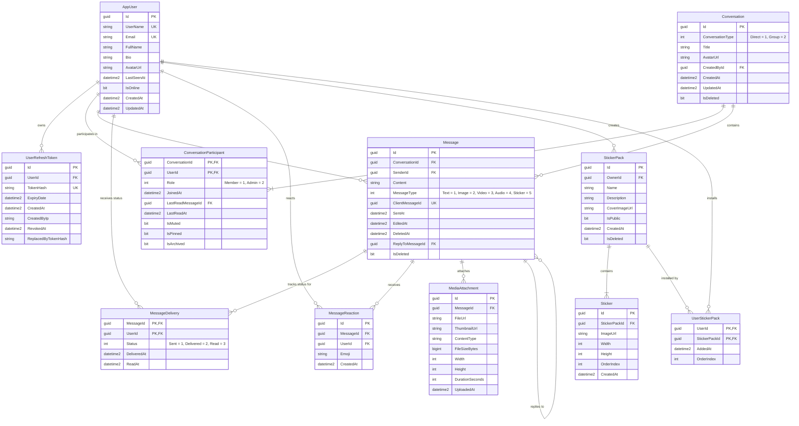

# ChatApp — Database Architecture & ERD Specification

**Document Version:** 1.0.0  
**Phase:** 1 — Product Discovery & Architecture  
**Database Engine:** Microsoft SQL Server 2022+ / SQL Server LocalDB  
**ORM:** Entity Framework Core 10  

---

## 1. Entity-Relationship Diagram (ERD)



---

## 2. Comprehensive Data Dictionary & Schema Definitions

### 2.1 Table: `AppUsers` (Extends `IdentityUser<Guid>`)
Stores user profiles and presence metadata integrated directly into ASP.NET Core Identity.

| Column | Data Type | Nullable | Constraints & Defaults | Description |
|---|---|---|---|---|
| `Id` | `UNIQUEIDENTIFIER` | NO | PK, `NEWSEQUENTIALID()` | Unique user identifier |
| `UserName` | `NVARCHAR(50)` | NO | Unique, Index | Normalized username |
| `Email` | `NVARCHAR(256)` | NO | Unique, Index | Normalized user email |
| `FullName` | `NVARCHAR(100)` | NO | | User display name |
| `Bio` | `NVARCHAR(250)` | YES | NULL | Optional status/bio |
| `AvatarUrl` | `NVARCHAR(500)` | YES | NULL | Remote URL of avatar image |
| `IsOnline` | `BIT` | NO | `DEFAULT 0` | Real-time presence flag |
| `LastSeenAt` | `DATETIME2(7)` | YES | NULL | Timestamp of last user activity |
| `CreatedAt` | `DATETIME2(7)` | NO | `SYSUTCDATETIME()` | Account creation timestamp (UTC) |
| `UpdatedAt` | `DATETIME2(7)` | YES | NULL | Last profile update timestamp (UTC) |

---

### 2.2 Table: `UserRefreshTokens`
Manages JWT refresh token lifecycle and security rotation.

| Column | Data Type | Nullable | Constraints & Defaults | Description |
|---|---|---|---|---|
| `Id` | `UNIQUEIDENTIFIER` | NO | PK, `NEWSEQUENTIALID()` | Primary Key |
| `UserId` | `UNIQUEIDENTIFIER` | NO | FK -> `AppUsers.Id` (Cascade) | User token owner |
| `TokenHash` | `NVARCHAR(128)` | NO | Unique Index | Salted SHA-256 hash of token |
| `ExpiryDate` | `DATETIME2(7)` | NO | | Token expiration time (UTC) |
| `CreatedAt` | `DATETIME2(7)` | NO | `SYSUTCDATETIME()` | Creation timestamp (UTC) |
| `CreatedByIp` | `NVARCHAR(50)` | YES | NULL | Client IP at generation |
| `RevokedAt` | `DATETIME2(7)` | YES | NULL | Revocation timestamp if invalidated |
| `ReplacedByTokenHash` | `NVARCHAR(128)`| YES | NULL | Successor token hash in rotation chain |

---

### 2.3 Table: `Conversations`
Represents direct 1-on-1 chats and multi-user group channels.

| Column | Data Type | Nullable | Constraints & Defaults | Description |
|---|---|---|---|---|
| `Id` | `UNIQUEIDENTIFIER` | NO | PK, `NEWSEQUENTIALID()` | Primary Key |
| `ConversationType` | `INT` | NO | `1 = Direct, 2 = Group` | Chat category |
| `Title` | `NVARCHAR(100)` | YES | NULL for Direct, Title for Group | Display title of conversation |
| `AvatarUrl` | `NVARCHAR(500)` | YES | NULL | Group icon URL |
| `CreatedById` | `UNIQUEIDENTIFIER` | NO | FK -> `AppUsers.Id` (Restrict) | Creator user identifier |
| `CreatedAt` | `DATETIME2(7)` | NO | `SYSUTCDATETIME()` | Creation timestamp (UTC) |
| `UpdatedAt` | `DATETIME2(7)` | YES | NULL | Last activity timestamp (UTC) |
| `IsDeleted` | `BIT` | NO | `DEFAULT 0` | Soft delete flag |

---

### 2.4 Table: `ConversationParticipants`
Composite join table establishing membership, administrative roles, and user-specific view state.

| Column | Data Type | Nullable | Constraints & Defaults | Description |
|---|---|---|---|---|
| `ConversationId` | `UNIQUEIDENTIFIER` | NO | PK, FK -> `Conversations.Id` (Cascade) | Conversation reference |
| `UserId` | `UNIQUEIDENTIFIER` | NO | PK, FK -> `AppUsers.Id` (Cascade) | User reference |
| `Role` | `INT` | NO | `1 = Member, 2 = Admin` | Participant privilege level |
| `JoinedAt` | `DATETIME2(7)` | NO | `SYSUTCDATETIME()` | Join timestamp (UTC) |
| `LastReadMessageId`| `UNIQUEIDENTIFIER` | YES | FK -> `Messages.Id` (Restrict) | Highest message ID read |
| `LastReadAt` | `DATETIME2(7)` | YES | NULL | Read timestamp (UTC) |
| `IsMuted` | `BIT` | NO | `DEFAULT 0` | Notification mute flag |
| `IsPinned` | `BIT` | NO | `DEFAULT 0` | Pinned to inbox top |
| `IsArchived` | `BIT` | NO | `DEFAULT 0` | Hidden from main inbox |

---

### 2.5 Table: `Messages`
Core ledger of all sent communication records.

| Column | Data Type | Nullable | Constraints & Defaults | Description |
|---|---|---|---|---|
| `Id` | `UNIQUEIDENTIFIER` | NO | PK, `NEWSEQUENTIALID()` | Unique message ID |
| `ConversationId` | `UNIQUEIDENTIFIER` | NO | FK -> `Conversations.Id` (Cascade) | Conversation thread reference |
| `SenderId` | `UNIQUEIDENTIFIER` | NO | FK -> `AppUsers.Id` (Restrict) | Author user identifier |
| `Content` | `NVARCHAR(MAX)` | YES | NULL if pure media | Encrypted or plaintext content |
| `MessageType` | `INT` | NO | `1: Text, 2: Image, 3: Video, 4: Audio, 5: Sticker` | Payload classification |
| `ClientMessageId`| `UNIQUEIDENTIFIER` | NO | Unique Index | Client-supplied UUID for idempotency |
| `SentAt` | `DATETIME2(7)` | NO | `SYSUTCDATETIME()` | Server ingestion timestamp (UTC) |
| `EditedAt` | `DATETIME2(7)` | YES | NULL | Timestamp of last edit |
| `DeletedAt` | `DATETIME2(7)` | YES | NULL | Timestamp of deletion |
| `ReplyToMessageId`| `UNIQUEIDENTIFIER`| YES | FK -> `Messages.Id` (Restrict) | Quoted parent message reference |
| `IsDeleted` | `BIT` | NO | `DEFAULT 0` | Soft delete flag |

---

### 2.6 Table: `MessageDeliveries`
Tracks delivery and read receipt status per recipient (essential for group conversations where each member has a distinct read state).

| Column | Data Type | Nullable | Constraints & Defaults | Description |
|---|---|---|---|---|
| `MessageId` | `UNIQUEIDENTIFIER` | NO | PK, FK -> `Messages.Id` (Cascade) | Target message |
| `UserId` | `UNIQUEIDENTIFIER` | NO | PK, FK -> `AppUsers.Id` (Restrict) | Recipient user |
| `Status` | `INT` | NO | `1 = Sent, 2 = Delivered, 3 = Read` | Receipt status |
| `DeliveredAt` | `DATETIME2(7)` | YES | NULL | Timestamp client received packet |
| `ReadAt` | `DATETIME2(7)` | YES | NULL | Timestamp user viewed message |

---

### 2.7 Table: `MessageReactions`
Emoji reactions attached to messages.

| Column | Data Type | Nullable | Constraints & Defaults | Description |
|---|---|---|---|---|
| `Id` | `UNIQUEIDENTIFIER` | NO | PK, `NEWSEQUENTIALID()` | Primary Key |
| `MessageId` | `UNIQUEIDENTIFIER` | NO | FK -> `Messages.Id` (Cascade) | Target message |
| `UserId` | `UNIQUEIDENTIFIER` | NO | FK -> `AppUsers.Id` (Restrict) | Reacting user |
| `Emoji` | `NVARCHAR(8)` | NO | | Unicode emoji character |
| `CreatedAt` | `DATETIME2(7)` | NO | `SYSUTCDATETIME()` | Reaction timestamp (UTC) |

> **Unique Constraint:** `(MessageId, UserId)` ensures a user can react only once per message (reacting again updates the emoji or removes it).

---

### 2.8 Table: `MediaAttachments`
Binary storage references for images, videos, and voice notes.

| Column | Data Type | Nullable | Constraints & Defaults | Description |
|---|---|---|---|---|
| `Id` | `UNIQUEIDENTIFIER` | NO | PK, `NEWSEQUENTIALID()` | Primary Key |
| `MessageId` | `UNIQUEIDENTIFIER` | NO | FK -> `Messages.Id` (Cascade) | Associated message |
| `FileUrl` | `NVARCHAR(500)` | NO | | Object storage / CDN URL |
| `ThumbnailUrl` | `NVARCHAR(500)` | YES | NULL | Low-resolution preview URL |
| `ContentType` | `NVARCHAR(100)` | NO | | MIME Type (e.g., `image/webp`) |
| `FileSizeBytes` | `BIGINT` | NO | | File size in bytes |
| `Width` | `INT` | YES | NULL | Media pixel width |
| `Height` | `INT` | YES | NULL | Media pixel height |
| `DurationSeconds`| `INT` | YES | NULL | Audio/Video duration in seconds |
| `UploadedAt` | `DATETIME2(7)` | NO | `SYSUTCDATETIME()` | Upload completion timestamp |

---

### 2.9 Tables: `StickerPacks`, `Stickers` & `UserStickerPacks`
Powers the custom sticker creation and marketplace ecosystem.

#### `StickerPacks`
| Column | Data Type | Nullable | Constraints & Defaults | Description |
|---|---|---|---|---|
| `Id` | `UNIQUEIDENTIFIER` | NO | PK, `NEWSEQUENTIALID()` | Primary Key |
| `OwnerId` | `UNIQUEIDENTIFIER` | NO | FK -> `AppUsers.Id` (Cascade) | Pack creator |
| `Name` | `NVARCHAR(100)` | NO | | Pack title |
| `Description` | `NVARCHAR(250)` | YES | NULL | Pack description |
| `CoverImageUrl` | `NVARCHAR(500)` | NO | | Primary icon / cover URL |
| `IsPublic` | `BIT` | NO | `DEFAULT 1` | Discoverable by community |
| `CreatedAt` | `DATETIME2(7)` | NO | `SYSUTCDATETIME()` | Creation timestamp |
| `IsDeleted` | `BIT` | NO | `DEFAULT 0` | Soft delete flag |

#### `Stickers`
| Column | Data Type | Nullable | Constraints & Defaults | Description |
|---|---|---|---|---|
| `Id` | `UNIQUEIDENTIFIER` | NO | PK, `NEWSEQUENTIALID()` | Primary Key |
| `StickerPackId` | `UNIQUEIDENTIFIER` | NO | FK -> `StickerPacks.Id` (Cascade) | Containing pack |
| `ImageUrl` | `NVARCHAR(500)` | NO | | Storage URL (WebP format) |
| `Width` | `INT` | NO | `DEFAULT 512` | Pixel width |
| `Height` | `INT` | NO | `DEFAULT 512` | Pixel height |
| `OrderIndex` | `INT` | NO | `DEFAULT 0` | Sort position within pack |
| `CreatedAt` | `DATETIME2(7)` | NO | `SYSUTCDATETIME()` | Creation timestamp |

#### `UserStickerPacks`
| Column | Data Type | Nullable | Constraints & Defaults | Description |
|---|---|---|---|---|
| `UserId` | `UNIQUEIDENTIFIER` | NO | PK, FK -> `AppUsers.Id` (Cascade) | User installer |
| `StickerPackId` | `UNIQUEIDENTIFIER` | NO | PK, FK -> `StickerPacks.Id` (Cascade) | Installed pack |
| `AddedAt` | `DATETIME2(7)` | NO | `SYSUTCDATETIME()` | Install timestamp |
| `OrderIndex` | `INT` | NO | `DEFAULT 0` | Sort order in user keyboard |

---

## 3. High-Performance Indexing Strategy

To guarantee sub-50ms query times at scale, the database utilizes strategic composite and filtered indexes:

```sql
-- 1. Conversation Message Feed (Cursor-based pagination)
CREATE NONCLUSTERED INDEX IX_Messages_ConversationId_SentAt
ON Messages (ConversationId, SentAt DESC)
INCLUDE (SenderId, MessageType, Content, IsDeleted);

-- 2. Inbox Conversations Sorting & Pinned View
CREATE NONCLUSTERED INDEX IX_ConversationParticipants_User_Pinned
ON ConversationParticipants (UserId, IsPinned DESC, JoinedAt DESC)
INCLUDE (ConversationId, IsArchived, IsMuted, LastReadMessageId);

-- 3. Idempotent Message Insertion Lookup
CREATE UNIQUE NONCLUSTERED INDEX UX_Messages_ClientMessageId
ON Messages (ClientMessageId);

-- 4. Active Refresh Token Lookup (Filtered Index)
CREATE NONCLUSTERED INDEX IX_UserRefreshTokens_Active
ON UserRefreshTokens (TokenHash)
INCLUDE (UserId, ExpiryDate)
WHERE RevokedAt IS NULL;

-- 5. User Search by Normalized Username & FullName
CREATE NONCLUSTERED INDEX IX_AppUsers_Search
ON AppUsers (UserName, FullName)
INCLUDE (AvatarUrl, Bio, IsOnline, LastSeenAt);

-- 6. Unread Message Receipt Calculations
CREATE NONCLUSTERED INDEX IX_MessageDeliveries_PendingReceipts
ON MessageDeliveries (UserId, Status)
INCLUDE (MessageId, DeliveredAt, ReadAt);
```

---

## 4. EF Core 10 Configuration & Global Query Filters

All queries for soft-deletable entities automatically exclude deleted records via EF Core configurations:

```csharp
modelBuilder.Entity<Message>()
    .HasQueryFilter(m => !m.IsDeleted);

modelBuilder.Entity<Conversation>()
    .HasQueryFilter(c => !c.IsDeleted);

modelBuilder.Entity<StickerPack>()
    .HasQueryFilter(sp => !sp.IsDeleted);
```

### Cascade Delete Cycle Prevention
SQL Server forbids multiple cascade paths on the same table (such as `Messages` referencing `AppUsers` as sender and `Conversations` as parent).  
- **Rule:** Cascading deletion is enabled from `Conversations` down to `Messages` and `ConversationParticipants`.
- **Foreign keys from `Messages.SenderId` to `AppUsers.Id` are explicitly configured with `DeleteBehavior.Restrict`** to preserve data integrity and prevent SQL Server cycle execution errors during migration.
