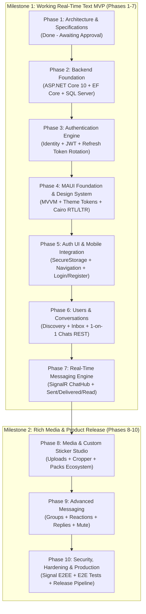

# ChatApp — Phased Engineering Roadmap & Delivery Milestones

**Document Version:** 1.0.0  
**Phase:** 1 — Product Discovery & Architecture  
**Execution Strategy:** Strict Phase-Gated AI Agent Pipeline  
**Target Runtime:** .NET 10 (ASP.NET Core Web API + .NET MAUI)  

---

## 1. Roadmap Overview & Phase Delivery Matrix

---

## 2. Phase-by-Phase Execution Plan

### Phase 1: Product Discovery & Architecture (Current Phase)
- **Status:** **Completed — Awaiting User Approval**
- **Deliverables:**
  - `REQUIREMENTS.md`
  - `ARCHITECTURE.md`
  - `DATABASE_DESIGN.md`
  - `API_DESIGN.md`
  - `ROADMAP.md`
- **Gate Check:** Architectural review sign-off by Technical Lead. No code is authored until full approval is granted.

---

### Phase 2: Backend Foundation
- **Role:** Senior ASP.NET Core Backend Developer
- **Objective:** Establish the clean solution architecture, EF Core database context, structured logging, centralized error handling, and health monitoring on .NET 10.
- **Key Tasks:**
  - Scaffold 4-layer solution: `ChatApp.Domain`, `ChatApp.Application`, `ChatApp.Infrastructure`, `ChatApp.API`.
  - Configure EF Core 10 with SQL Server / LocalDB.
  - Setup ASP.NET Core Identity Core abstractions.
  - Configure Serilog structured logging and RFC 7807 Exception Handling Middleware.
  - Setup Swagger/OpenAPI with JWT Bearer security scheme.
  - Add basic health checks (`/health`).
- **Exit Gate:** Clean build with zero warnings; initial EF Core migration created and applied; Swagger loads and `/health` returns `200 OK`.

---

### Phase 3: Authentication System
- **Role:** Senior ASP.NET Core Backend Developer
- **Objective:** Build robust identity management and token security.
- **Key Tasks:**
  - Implement User Registration with password hashing and uniqueness validation.
  - Implement Login returning short-lived JWT + cryptographically secure Refresh Token.
  - Implement Refresh Token Rotation with salted SHA-256 hash storage and token-family compromise detection.
  - Implement Logout and token revocation.
  - Create `GET /api/v1/users/me` endpoint.
  - Unit and integration tests covering positive and negative auth scenarios.
- **Exit Gate:** Automated tests pass for registration, login, token rotation, and unauthorized access.

---

### Phase 4: MAUI Foundation & Design System
- **Role:** Senior .NET MAUI Engineer & Mobile UI/UX Architect
- **Objective:** Build a resilient, high-performance mobile UI foundation.
- **Key Tasks:**
  - Scaffold `ChatApp.Mobile` on .NET 10 targeting Android and iOS.
  - Integrate `CommunityToolkit.Mvvm` and `CommunityToolkit.Maui`.
  - Establish centralized Design Tokens: Colors, Typography (Cairo font for Arabic, Inter for English), Spacing scale.
  - Build Light and Dark theme dictionaries with on-the-fly switching.
  - Implement AppShell navigation hierarchy and custom `INavigationService`.
  - Create reusable core controls: `AvatarView`, `StateContainer`, `BadgeIndicator`.
- **Exit Gate:** Mobile project compiles cleanly on .NET 10 with responsive theme toggling and RTL/LTR layout verification.

---

### Phase 5: Authentication UI & API Integration
- **Role:** Full-Stack Mobile Engineer
- **Objective:** Connect the mobile client to the authentication API.
- **Key Tasks:**
  - Create Splash Screen, Welcome Screen, Login Page, Register Page, and Profile Setup Page.
  - Implement client-side validation using MVVM Toolkit attributes.
  - Connect via `IHttpClientFactory` to backend endpoints with timeout and retry policies.
  - Persist JWT access and refresh tokens in `MAUI SecureStorage`.
  - Implement authenticated route routing and automatic token refresh interceptor.
- **Exit Gate:** User can register, log in, view their profile, and log out with secure token storage verified.

---

### Phase 6: Users & Conversations
- **Role:** Full-Stack Engineer
- **Objective:** Implement user discovery and conversation management.
- **Key Tasks:**
  - Backend: User search endpoint, direct conversation creation logic, inbox conversation listing with unread count.
  - Mobile: `UserSearchPage`, `ConversationsPage`, `ConversationItemView`.
  - Implement pin and archive conversation state.
  - Prevent duplicate direct conversation creation.
- **Exit Gate:** User can search another user, start a conversation, and see the active thread in their inbox.

---

### Phase 7: Real-Time Messaging (SignalR) — MVP Milestone
- **Role:** Real-Time Distributed Systems Engineer
- **Objective:** Deliver the core real-time text chat experience.
- **Key Tasks:**
  - Build `ChatHub` with JWT authentication and conversation authorization.
  - Implement bidirectional text messaging with server-side persistence and idempotency (`ClientMessageId`).
  - Implement Tri-State status indicators: `Sent` -> `Delivered` -> `Read`.
  - Implement live typing indicators with debounced timeouts.
  - Mobile: `ChatPage`, virtualized `MessageBubble` template, auto-scroll to bottom, input bar with send button.
  - Implement connection state indicator and auto-reconnection with synchronization.
- **Exit Gate:** Two separate authenticated clients communicate in real-time with instant message status transitions verified.

---

### Phase 8: Media & Custom Sticker Studio
- **Role:** Mobile Multimedia & Backend Storage Specialist
- **Objective:** Implement media attachments and the differentiating sticker ecosystem.
- **Key Tasks:**
  - Backend: Object storage service (`IStorageService`) with image/video/audio validation, MIME verification, and thumbnail generation.
  - Mobile Sticker Maker: Photo picker, bounding box cropper, text caption overlays, decoration stamps, export to 512x512 WebP.
  - Sticker Packs: Create packs, install community packs, render in dedicated in-chat sticker keyboard.
  - Chat integration: Render image, video, audio waveforms, and stickers inside chat bubbles.
- **Exit Gate:** User creates a custom sticker from a camera photo, saves it into a pack, and sends it in a chat session.

---

### Phase 9: Advanced Messaging Features
- **Role:** Senior Full-Stack Engineer
- **Objective:** Expand ChatApp into a feature-rich communication platform.
- **Key Tasks:**
  - Group Conversations: Create group, designate admins, add/remove members, group info page.
  - Message actions: Quoted replies, message forwarding, emoji reactions, edit message (15m window), soft-delete.
  - Pinned messages in conversations.
  - Privacy controls: Toggle visibility of last seen and online presence.
- **Exit Gate:** Group communication and message moderation rules pass full automated integration testing.

---

### Phase 10: Security Hardening & Production Readiness
- **Role:** Senior Security Engineer & Production Architect
- **Objective:** Prepare ChatApp for enterprise production release.
- **Key Tasks:**
  - Implement End-to-End Encryption (E2EE) using the Double Ratchet Protocol (Signal standard).
  - Configure API rate limiting, IP protection, and anti-abuse policies.
  - Optimize database queries with execution plan reviews and covering index analysis.
  - Mobile memory leak profiling and collection virtualization benchmarking.
  - Production containerization (`Dockerfile`, Docker Compose) and release signing configurations (Android APK/AAB, iOS IPA).
- **Exit Gate:** Complete security audit, passing test coverage report (>85%), and signed release build verification.

---

## 3. Strict Quality Gates & Review Checklist

Before any phase is marked complete, the AI Agent must execute the following automated validation protocol:

1. **Compilation Check:** Solution builds with `0 Errors` and `0 Warnings`.
2. **Test Execution:** All automated unit and integration tests pass successfully.
3. **Contract Integrity:** Existing API contracts and database schema invariants are preserved without breaking changes.
4. **Code Quality Review:** Execution of the standardized Code Review Prompt assessing SOLID principles, async/await correctness, and security vulnerabilities.
5. **Human Approval:** Explicit confirmation from the User / Technical Lead before proceeding to the next prompt.
